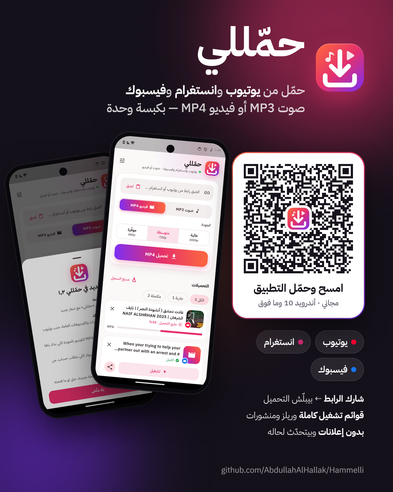

# حمّللي — Hammelli

تحميل المقاطع من يوتيوب وانستغرام وفيسبوك كصوت MP3 أو فيديو MP4، مباشرة على الهاتف.

## التنزيل
**[⬇ تنزيل أحدث إصدار (Hammelli.apk)](https://github.com/AbdullahAlHallak/Hammelli/releases/latest/download/Hammelli.apk)**

للهواتف القديمة ذات معالج ٣٢-بت: [Hammelli-old-phones.apk](https://github.com/AbdullahAlHallak/Hammelli/releases/latest/download/Hammelli-old-phones.apk)

> عند التثبيت قد يطلب أندرويد السماح بـ«التثبيت من مصادر غير معروفة» للمتصفح. يعمل على أندرويد 10 وما فوق.

### أو امسح الكود من جوالك

